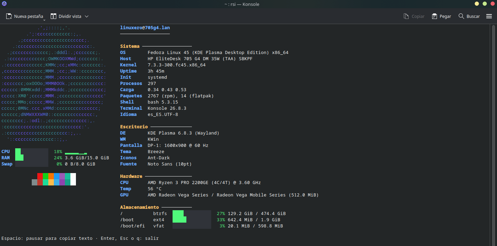
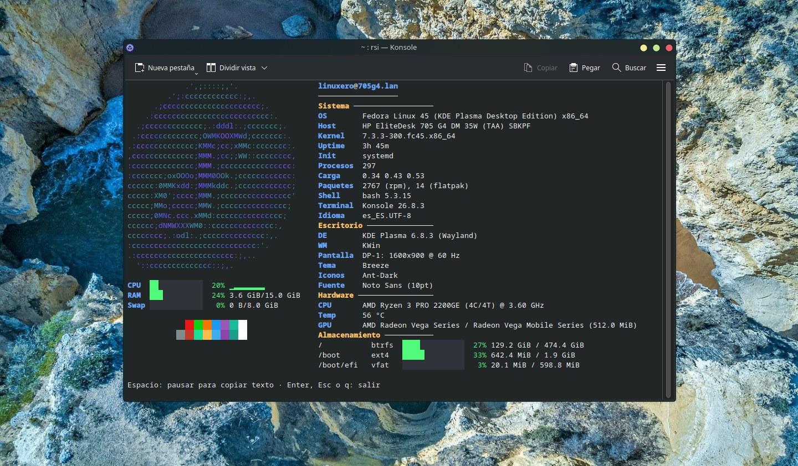

<div align="center">

# rsi — rustsysteminfo

Información del sistema con logo animado y monitor en vivo, en un único binario de Rust.
Una alternativa moderna a Neofetch y Fastfetch.

[](https://github.com/Linuxero-dev/rustsysteminfo/actions/workflows/release.yml)
[](https://github.com/Linuxero-dev/rustsysteminfo/actions/workflows/audit.yml)
[](https://github.com/Linuxero-dev/rustsysteminfo/releases)
[](LICENSE)



</div>

## Por qué rsi

- **En vivo**: CPU, RAM y swap se actualizan en pantalla, con el logo animado.
- **Completo**: WM, resolución con frecuencia de refresco, temperatura de CPU, VRAM de la GPU, paquetes, shell con versión, discos con barras y más.
- **Configurable**: oculta lo que no quieras (`--no-ip`), fija tus opciones en `~/.config/rsi/config` y elige el logo.
- **Para scripts**: `--json` imprime todos los datos en JSON.
- **Sin dependencias en tiempo de ejecución**: un solo binario estático para x86_64 y ARM64.
- **Seguro por diseño**: el instalador verifica el SHA256 y la procedencia, y rsi limpia de secuencias de escape todo texto que lee del sistema.
- **Se ve bien en cualquier terminal**: truecolor, 256 colores o 16, con `NO_COLOR` respetado y ancho correcto para CJK y emojis.

## Novedades en 0.5.4

- **Corrección importante:** si cerrabas la terminal (o se caía una sesión SSH) con `rsi` en marcha, el proceso podía quedarse vivo girando al 100 % de un núcleo hasta que lo matabas a mano. Ahora termina solo en ~1 segundo.

## Novedades en 0.5.3

- **Paquete `.rpm`** para Fedora, openSUSE y derivadas (`x86_64` y `aarch64`).
- Cada release se prueba instalando los paquetes en Ubuntu, Debian, Fedora y openSUSE.

## Novedades en 0.5.2

- **Paquete `.deb`** para Debian, Ubuntu, Pop!_OS, Mint y derivadas (`amd64` y `arm64`), publicado en cada release con su SHA256 y su procedencia.
- El instalador avisa si ya tienes el paquete instalado, para que no queden dos copias.

## Novedades en 0.5.1

- **Instalador más inteligente**: comprueba que `rsi` se ejecuta tras instalar, detecta si no está en el PATH o si otro `rsi` lo tapa, y da la línea exacta para tu shell (bash, zsh o fish). Usa `wget` si no hay `curl`.
- **Menos CPU**: la tabla de colores del logo se calcula una vez y el monitor refresca solo el uso de CPU.
- **Caché privada** (`0700`/`0600`) y huellas correctas para NixOS y Gentoo.

## Novedades en 0.5.0

- **Caché de paquetes y GPU** en `~/.cache/rsi`: el arranque en caliente pasa de ~880 ms a ~30-50 ms.
- **Corrección crítica de estabilidad**: los procesos huérfanos que consumían un núcleo completo al perder la terminal ahora salen limpiamente.
- **Recorte con elipsis** (`…`) cuando el texto no cabe en la terminal.
- **Anchos Unicode correctos** para símbolos (⌚⏰✅❌), emojis (🟠🩷🀄) y banderas.
- **Paleta de colores visible** con marco gris en lugar de cuadro negro invisible.

<details>
<summary>Más capturas</summary>



</details>

## Instalación

Funciona en cualquier distribución Linux (x86_64 y ARM64) sin necesidad de tener Rust instalado.

```sh
curl -sSL https://raw.githubusercontent.com/Linuxero-dev/rustsysteminfo/main/install.sh | sh
```

Instala `rsi` en `/usr/local/bin`, disponible para todos los usuarios, y pide `sudo` solo en ese momento. Si no hay `sudo` o no puedes usarlo, lo instala en `~/.local/bin`. Si ya eres root, no hace falta `sudo`.

Otras formas:

```sh
# solo para tu usuario, sin sudo
curl -sSL https://raw.githubusercontent.com/Linuxero-dev/rustsysteminfo/main/install.sh | sh -s -- --local

# una versión concreta
curl -sSL https://raw.githubusercontent.com/Linuxero-dev/rustsysteminfo/main/install.sh | RSI_VERSION=v0.5.4 sh

# desinstalar
curl -sSL https://raw.githubusercontent.com/Linuxero-dev/rustsysteminfo/main/install.sh | sh -s -- --uninstall
```

El instalador comprueba siempre el SHA256 y, si tienes la CLI `gh`, también la procedencia del binario (ver [SECURITY.md](SECURITY.md)). Al terminar ejecuta `rsi --version` para confirmar que funciona.

### Paquete `.deb` (Debian, Ubuntu, Pop!_OS, Mint…)

Descarga el `.deb` de tu arquitectura desde [Releases](https://github.com/Linuxero-dev/rustsysteminfo/releases/latest) (`amd64` para PCs normales, `arm64` para ARM) e instálalo con `apt`, que resuelve todo y permite desinstalar con `sudo apt remove rustsysteminfo`:

```sh
sudo apt install ./rustsysteminfo_0.5.4_amd64.deb
```

Instala `rsi` en `/usr/bin`, con la página de manual y el completado de bash, zsh y fish. Es estático: no depende de ningún otro paquete.

### Paquete `.rpm` (Fedora, openSUSE…)

Descarga el `.rpm` de tu arquitectura desde [Releases](https://github.com/Linuxero-dev/rustsysteminfo/releases/latest) (`x86_64` o `aarch64`):

```sh
# Fedora, RHEL y derivadas
sudo dnf install ./rustsysteminfo-0.5.4-1.x86_64.rpm

# openSUSE
sudo zypper install --allow-unsigned-rpm ./rustsysteminfo-0.5.4-1.x86_64.rpm
```

Se desinstala con `sudo dnf remove rustsysteminfo` o `sudo zypper remove rustsysteminfo`.

> **Usa un solo método.** El script (`curl`) instala en `/usr/local/bin`, que tiene prioridad sobre `/usr/bin`. Si usas ambos acabarás ejecutando la copia del script. Para quedarte con el paquete: `sudo rm /usr/local/bin/rsi`.

Si no tienes `curl`, el instalador funciona igual con `wget`:

```sh
wget -qO- https://raw.githubusercontent.com/Linuxero-dev/rustsysteminfo/main/install.sh | sh
```

### Si «rsi» no se encuentra

Con `--local`, o si no había `sudo`, el binario queda en `~/.local/bin`. Algunas distribuciones (Ubuntu, Pop!_OS) solo añaden esa carpeta al PATH al iniciar sesión **si ya existía**. El instalador te avisa y te da la línea exacta; basta cerrar y abrir la terminal, o añadir:

```sh
echo 'export PATH="$HOME/.local/bin:$PATH"' >> ~/.bashrc   # bash
fish_add_path ~/.local/bin                                  # fish
```

Si el sistema responde «Command 'rsi' not found, but can be installed with apt», es solo la sugerencia genérica de la distribución: ese paquete no es este programa.

## Uso

```sh
rsi                    # monitor en vivo (Enter, Esc o q para salir)
rsi --once             # imprime una vez y sale
rsi --json             # datos en JSON, para scripts
rsi --no-ip            # oculta la IP local
rsi --hide ip,gpu      # oculta varios módulos
rsi --logo arch        # fuerza un logo
rsi --no-logo          # sin logo
```

| Opción | Descripción |
|---|---|
| `-h`, `--help` | muestra la ayuda |
| `-V`, `--version` | muestra la versión |
| `--once` | imprime una vez y sale |
| `--no-anim` | logo estático |
| `--json` | imprime los datos en JSON y sale |
| `--logo NOMBRE` | fuerza un logo (`--list-logos` los muestra) |
| `--no-logo` | no muestra el logo |
| `--no-MÓDULO` | oculta un módulo, por ejemplo `--no-ip` |
| `--hide A,B` | oculta varios módulos a la vez |
| `--show A,B` | muestra módulos que la configuración oculta |
| `--list-logos`, `--list-modules` | listan los logos y los módulos disponibles |
| `--config RUTA`, `--no-config` | usa otro fichero de configuración, o ninguno |
| `--gen-config` | imprime una configuración de ejemplo |
| `--completions SHELL` | imprime el completado para `bash`, `zsh` o `fish` |

Módulos: `os`, `host`, `kernel`, `uptime`, `init`, `processes`, `load`, `packages`, `shell`, `terminal`, `locale`, `ip`, `de`, `wm`, `display`, `theme`, `icons`, `font`, `cpu`, `temp`, `gpu`, `battery`, `disks`, `colors`.

La variable `NO_COLOR` desactiva los colores. Con terminales de 256 colores o *truecolor* se usa la mejor paleta disponible.

## Configuración

Para no repetir opciones, crea `~/.config/rsi/config` (o `$XDG_CONFIG_HOME/rsi/config`):

```sh
mkdir -p ~/.config/rsi
rsi --gen-config > ~/.config/rsi/config
```

```ini
# ~/.config/rsi/config
hide = ip,gpu
logo = arch
```

Claves: `hide`, `logo`, `no_logo` y `animate`. Las opciones de la línea de comandos tienen prioridad sobre el fichero (`--show ip` anula un `hide = ip`).

## Completado de comandos

```sh
# bash
mkdir -p ~/.local/share/bash-completion/completions
rsi --completions bash > ~/.local/share/bash-completion/completions/rsi

# zsh (con ~/.zfunc en el fpath)
rsi --completions zsh > ~/.zfunc/_rsi

# fish
rsi --completions fish > ~/.config/fish/completions/rsi.fish
```

## Notas

- La temperatura de la CPU se lee de `hwmon`; la VRAM, de sysfs (AMD) o de `nvidia-smi` (NVIDIA), y solo se muestra con una única GPU.
- La frecuencia de refresco sale del EDID de la pantalla, así que puede faltar en algunos monitores.
